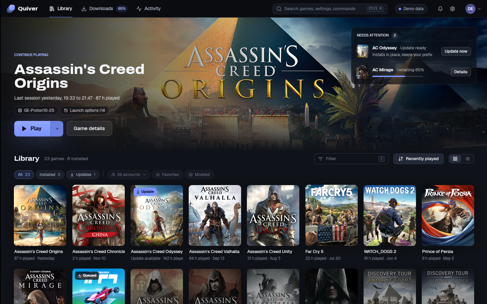
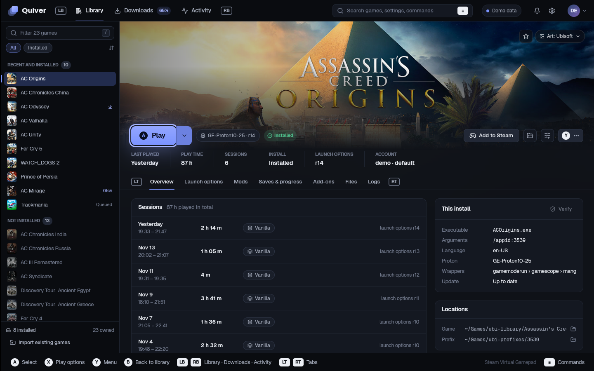

# Quiver

A third-party launcher for your Ubisoft library on Linux. Not affiliated with or endorsed by
Ubisoft.

A native Linux client for a Ubisoft library: sign-in, library, installs and updates, one Proton
prefix per game, cloud saves, play time, mod overlays and Steam/desktop shortcuts, all without
running `UbisoftConnect.exe`. A daemon (`quiverd`) owns everything; the desktop app, the
`quiver` CLI and scripts or agents all drive it the same way.



| Game page (controller) | Launch options with history | Light theme (follows Omarchy) |
|---|---|---|
|  |  |  |

<sub>Screenshots use the app's demo data (`QUIVER_DEMO=1`); box art is Ubisoft's, shown from
their asset CDN.</sub>

## Layout

- `proto/`: Ubisoft Connect protobuf definitions, vendored (see `proto/README.md`)
- `crates/quiver-proto/`: generated protobuf types
- `crates/quiver-core/`: UbiServices auth, the demux client, ownership/library and manifest parsing
- `crates/quiver-cli/`: the `quiver` command (and `ubi`, its pre-Quiver name)
- `crates/quiver-ipc/`: types shared by the native side and the bridge
- `crates/quiver-bridge/`: a Windows binary that runs inside the game's prefix in place of Connect
- `mods/<product id>/<mod id>/quiver-mod.toml`: Quiver's built-in mods (audited recipes,
  compiled into `quiver-core`)
- `tools/instance.sh`: per-game reflinked prefixes, run headless in podman
- `tools/recon/`: SDK harness and the offline recon prefix scripts

## How a game runs without Connect

The game's `uplay_r1_loader64.dll` loads Ubisoft's own `uplay_r164.dll` and `uplay_aux_r164.dll`
from the Connect install directory, unmodified. They reach Connect through named pipes
(4-byte big-endian length + protobuf), and `quiver-bridge` owns those pipes:

| Pipe | Protocol | What the bridge does |
|---|---|---|
| `terminal_1_uplay_aux_ipc_pipe_` | `uplayauxdll` | init, then Denuvo activation: forwards the request token to the broker in `quiverd` |
| `terminal_1_uplay_api_process_ipc_pipe_` | `uplaydll` | `InitProcessReq` handshake |
| `terminal_1_uplay_ipc_pipe_` | `uplaydll` | `InitReq` (account, ticket, owned IDs, CD keys), then the SDK API |

- **`UPLAY_ARGUMENTS`:** the game must be started with this set to
  `-upc_uplay_id <id> -upc_game_version 1 -upc_exe_path <b64> -upc_working_directory <b64>`.
  Otherwise the aux DLL relaunches it through `UbisoftGameLauncher.exe`.
- **Broker (in `quiverd`):** runs on the host and holds the Ubisoft session. For a Denuvo token it fetches
  an `ownership_service` ownership token, then calls `denuvo_service.GetGameTokenReq`.

## Debugging a game against the bridge

- `tools/recon/sdk-proxy`: a logging stand-in for `uplay_r1_loader64.dll` (`install.sh install|remove`).
  Diffing its log from a real Connect session against a bridge session is the fastest way to find
  what the bridge gets wrong. That's how the missing account email (which stops Origins from
  listing saves) was found.
- `tools/proto-extract/extract.py <binary>`: dump the protobuf schemas embedded in Ubisoft binaries.
- `QUIVER_TRACE=+file tools/instance.sh run ...` then `tools/instance.sh trace-grep <name> <regex>`.

## Architecture

```
 quiver-app (GPUI)   quiver (CLI)   scripts / agents
            \              |              /
             +---- quiver-api: JSON lines over $XDG_RUNTIME_DIR/quiver/quiverd.sock
                            |
                        quiverd  (daemon; started on demand by any client)
            session · library · installs · launches · settings history · activity log
                 · Denuvo token broker for every running game's quiver-bridge
                            |
                         quiver-core (Ubisoft protocols, installer, saves, launcher)
```

Front ends hold no state. Every request carries a source label (`gui`, `cli`, or whatever
`--source`/`QUIVER_SOURCE` says), so the activity log and each game's settings history show who
changed what. Clients outlive a daemon restart: they reconnect on their own, renew their event
subscription, and never resend a request the old daemon may already have run.

### Daemon lifecycle

`quiverd` is started on demand by any client (or by its systemd user unit, if enabled) and
runs until `quiver daemon stop`. When a new build is installed over the binary it was started
from (`tools/install-user.sh`, pacman, or a `cargo build` of a dev checkout), it restarts
itself onto it **once nothing needs it**, for 30 s in a row (`QUIVER_RESTART_IDLE_SECS`;
`QUIVER_AUTO_RESTART=0` turns this off):

- **Busy:** any game session (launched by Quiver, Steam or a container bridge), a game
  Quiver is starting, an install, update, repair, verify or import that is running (a
  paused or waiting queue isn't: the queue is saved and resumes), a perf subscription
  (`quiver perf watch`) or attached HUD, a sign-in waiting for its 2FA code, a bridge
  connected to the broker, a request in flight, or a **hold**.
- **Not busy:** app windows and other event subscribers, and finished one-shot commands.
- **Holds:** `quiver daemon hold --reason "…"` holds until that command exits (Ctrl-C, or
  its process dies); `--for 2h` holds for that long (at most 24 h) and returns at once.
  `quiver daemon release [ID|--all]` ends one early.
- **The restart:** quiverd stops accepting connections, checks once more and starts
  refusing requests in one step (so a launch can't slip in), tells subscribers (the app
  shows "quiverd updated to …"), then execs the new build in the same process, handing
  over its socket and the broker's port, so nothing that connects meanwhile is turned away.
  Requests it refused, or never answered, are sent again by the client to the new build
  (for up to 30 s), so a `quiver play` during a restart still starts the game. One line in
  the activity log records each restart.

`quiver daemon status` shows the build and commit, whether an update is staged, what the
restart is waiting on ("waiting on: Assassin's Creed Origins (bridge), 1 perf subscription")
and the holds.

## Install

```sh
rustup target add x86_64-pc-windows-gnu
tools/install-user.sh                          # build and install into ~/.local (no root); again to upgrade
tools/package.sh                               # or: an Arch package (quiver-git) for /usr
```

See [packaging/arch/README.md](packaging/arch/README.md) for what goes where, upgrades and
switching from a build directory.

## Usage

To run straight from a build directory instead:

```sh
rustup target add x86_64-pc-windows-gnu
cargo build --release -p quiver-bridge --target x86_64-pc-windows-gnu
cargo build --release
export PATH=$PWD/target/release:$PATH

quiver login                                   # email, password, 2FA (or sign in from the app)
quiver login                                   # again: adds a second account (first stays default)
quiver account list                            # signed-in accounts; * marks the default
quiver account default family                  # change the default (by name or user id)
quiver logout family                           # sign one account out (default: the default)
quiver-app                                     # the app; relaunches itself on the same screen when its
                                               # binary is rebuilt; under Hyprland, on the same workspace
                                               # and spot, without taking focus (QUIVER_AUTO_RELAUNCH=0: off)
quiver library                                 # owned games, install state, owners (2+ accounts); Steam copies too
quiver ownership 66088                         # Ubisoft's raw ownership record: why a game is (not) listed
quiver install "chronicles china"              # by name or product id; shows progress
quiver play rabbids                            # runs in its own prefix; syncs cloud saves
quiver set origins proton=GE-Proton10-34 env.DXVK_HUD=fps -m "test HUD"
quiver history origins                         # every revision, with who made it
quiver restore origins 2                       # make revision 2 current again (0 = defaults)
quiver --source agent set origins wrappers=gamemoderun,mangohud
quiver activity                                # recent actions across GUI/CLI/agents
quiver watch                                   # live daemon events (JSON)
quiver daemon status                           # build, staged update, what a restart onto it waits on
quiver daemon hold --reason "benchmark" --for 2h   # keep quiverd from restarting onto a new build
quiver daemon release 3                        # end hold #3 early (--all: every hold)
quiver daemon stop                             # exit (refused while a game runs)
quiver export desktop origins [--remove]       # ~/.local/share/applications/quiver-<id>.desktop
quiver export steam origins [--user NAME]      # non-Steam shortcut with Ubisoft art (staged while Steam runs)
quiver export list                             # exports and whether they're still as written
quiver steam users                             # Steam users; which one gets shortcuts
quiver steam restart                           # asks first; writes staged shortcuts and launch options while Steam is closed
quiver steam-run --product 66088 %command%     # as a Steam game's launch options: Steam copies of Ubisoft games use Quiver, not Connect
quiver steam games                             # Ubisoft games installed through Steam; which start through Quiver
quiver steam patch "black flag"                # set its launch options to use Quiver (keeps yours); or an app id, or `all`
quiver steam unpatch "black flag"              # put its launch options back the way they were
quiver steam offers off                        # don't offer the switch when a Ubisoft game is installed through Steam
quiver info origins [--all]                    # publisher, links, size, languages, add-ons (store links for unowned)
quiver progress origins                        # Ubisoft play time, stats, rewards, achievements, Connect level/units
quiver saves origins [--local]                 # local vs cloud slots (sizes, times, which is newer), backups
quiver saves origins restore latest            # backs up the current saves first; agents need your OK
quiver dev …                                   # low-level tools that bypass the daemon

quiver mods odyssey layer add ReShade ~/mods/reshade   # copy a folder laid out like the install
quiver mods odyssey layer add "No intro" --delete videos/intro.bik --delete videos/logo.bik
quiver mods odyssey layer delete-files "No intro" videos/credits   # keep-files PATH… takes it back
quiver mods odyssey layer show "No intro"      # files, origin, what it deletes; history / restore N
quiver mods odyssey profile create "Visual overhaul" --layers hd-textures,ReShade
quiver mods odyssey profile set "Visual overhaul" dll.dxgi=n,b cloud_saves=on
quiver mods odyssey list                       # layers, profiles, file conflicts between layers
quiver play odyssey --profile "Visual overhaul"  # or --profile-id p7f3k2q; vanilla by default
quiver mods odyssey profile history "Visual overhaul"
quiver mods odyssey profile delete "Visual overhaul"   # restorable; saves are kept

quiver mods "far cry 4" catalog                # built-in mods (audited recipes, with sources)
quiver mods "far cry 4" install fc4-raw-mouse  # or a package folder with a quiver-mod.toml
quiver mods "far cry 4" profile set Mouse mods=fc4-skip-intro,fc4-raw-mouse
quiver mods "far cry 4" profile set Mouse profile_config="drive_c/users/steamuser/Documents/My Games/Far Cry 4"
quiver mods "far cry 4" profile set Mouse separate_saves=on   # or off, or auto (the default)
quiver mods "far cry 4" plan Mouse             # settings, saves, mounts, own folders, config patches
quiver mods "far cry 4" show fc4-raw-mouse     # what it declares, where it's used, what it changed
quiver mods "far cry 4" set fc4-raw-mouse enabled=off   # also save_compatible=, kind=, name=
quiver mods "far cry 4" uninstall fc4-raw-mouse   # config values it changed go back
quiver fixes-on-vanilla on                     # installed fixes also apply to unmodded launches

quiver setup                                   # first-run choices (the app's welcome): install folder, importing
                                               # Connect downloads, Steam games and shortcuts, fixes; --show prints them
quiver install origins --dry-run               # sizes, free space, languages; nothing starts
quiver queue                                   # the download queue: state, progress, speed
quiver queue move origins top                  # or up / down
quiver pause origins                           # stops at a slice boundary; keeps its place
quiver resume origins                          # also retries a failed item
quiver queue remove origins                    # files stay; installing again resumes
quiver queue settings --max-active 1 --limit 20M --auto-update off
quiver update origins --preview                # files changed/added/removed, bytes to fetch
quiver verify origins [--repair]               # hash files against the manifest; repair fetches only bad slices
```

## Ubisoft games bought on Steam

A Steam copy of a Ubisoft game normally opens Ubisoft Connect first. With its Steam launch options
set to `<abs path>/quiver --source steam steam-run --product <id> %command%`, Steam's own Proton runs Quiver's
bridge instead: no Connect window, no second sign-in, and play time is reported through `quiverd`.
Nothing in the game's prefix changes, and clearing the launch option undoes it.

`quiver steam patch` (and the app: the welcome's Steam step, Settings › Steam and shortcuts, the
game page) writes that launch option for you, in the Steam user's
`userdata/<id>/config/localconfig.vdf` (`UserLocalConfigStore/Software/Valve/Steam/apps/<appid>/LaunchOptions`).
Quiver always writes the Ubisoft product id (`--product`), so you can see which game it starts;
`steam-run` without it finds the id itself where it can, and options written that way (or typed by
hand) count as switched and are left alone. Your own options are kept: `FOO=1 %command% -bar`
becomes `FOO=1 /…/quiver --source steam steam-run --product 66088 %command% -bar`, and options
without `%command%` are kept as game arguments after it.
`quiver steam unpatch` restores exactly what was there (or, if you edited it since, takes only
Quiver's part out). The path is absolute because Steam's `PATH` usually lacks `~/.local/bin`.

Ubisoft games are found in every Steam library (`libraryfolders.vdf`, `appmanifest_*.acf`): by
the install script registering `Ubisoft\Launcher\Installs\<id>` (which also gives the product
id), by Connect's SDK loaders or installer in the game folder, or by a small table; the product id
otherwise comes from the prefix's registry or a same-named game in your library. Steam rewrites
`localconfig.vdf` when it exits, so while Steam runs the change is staged: it's written when Steam
closes (quiverd checks every 30 s), on `quiver steam apply`, or by `quiver steam restart`, which
always asks first. The restart itself (from the CLI or the app's "Restart Steam") is done by
`quiverd` once you've confirmed, so it always writes what quiverd staged; if anything can't be
written it says so instead of reporting success. `quiverd` also notices Ubisoft games newly installed through Steam and offers the
switch once (an Activity entry, and a card in the app); "Not now" isn't asked again, and
`quiver steam offers off` stops the offers. Steam from Flatpak isn't supported (its sandbox can't run
`quiver`).

Steam copies are library games. A game bought on Steam is on your Ubisoft account without a
Ubisoft PC build, so it used to be missing; now every Ubisoft game Steam has installed is listed
("Installed via Steam", "Owned on Steam" when Ubisoft has no build of it), with its art, details,
progression, Ubisoft play time and saves (read from Steam's compatibility folder). Play
(`quiver play`, the app) asks Steam to start it (`steam://rungameid/<appid>`); Steam installs,
updates, verifies and uninstalls it. A session started through `steam-run` shows as started
from Steam. `steam-run` also applies the game's Quiver launch settings: `env.*`, `dll.*`
(merged into `WINEDLLOVERRIDES`), `args` (after the game's) and `wrappers` (in front of Steam's
command); Proton and language stay Steam's; `--no-settings` skips them. Mod profiles for Steam
copies are designed in [design/STEAM-COPIES.md](design/STEAM-COPIES.md), not built.

## Epic Games Store

Epic games are in the same library, with an Epic badge (`quiver library --store epic`,
`quiver info epic:<app>`). This build lists them as not installed; installing and playing them
natively comes next (design/STORE-EPIC.md). Ubisoft games bought on Epic (Epic's catalog names
the Ubisoft product) fold into their Ubisoft entry once your Ubisoft account has them, and
Quiver plays them as Ubisoft games.

```sh
quiver epic login            # Epic's sign-in page in Quiver's sign-in window
quiver epic login --paste    # prints the page instead; sign in in a browser, paste the code
quiver epic login --open     # same, and opens the page in your browser
quiver epic login --code <code or the page's JSON>
quiver epic accounts         # * marks the default; several accounts are fine
quiver epic default <name>
quiver epic logout [<name>]
```

The app has the same in Settings › Accounts › Epic Games. You sign in on Epic's own page: Quiver
never sees your password. The sign-in window is `quiver-webview`, a small separate program that
shows Epic's page with WebKitGTK and hands Quiver the code Epic's last page shows; it keeps no
cookies (its website data lives in memory, and anything else it writes goes to a private folder
deleted when it closes). It needs `webkit2gtk-4.1` (an optional dependency, loaded only when the
window opens); without it, or without a display, Quiver falls back to the browser and a pasted
code. The session goes into your desktop keyring (Secret Service, service
`quiver`, entry `epic:<account id>`), never into a file; `<data>/epic/accounts.json` holds only
ids, display names and the linked Ubisoft account. Epic rotates its refresh tokens, and Quiver
stores the new one before using it. When Epic ends a session the account is marked "sign in
again"; Quiver never signs in on its own. Only you can sign in or out: requests from agents and
scripts are refused. Quiver never reads another launcher's Epic session (legendary's
`user.json`, Heroic's or the Epic Games Launcher's data).

**Cloud saves, play time, achievements.** For an Epic game whose catalog names a save folder,
Quiver syncs Epic's launcher cloud saves: it downloads what's newer before a launch (backing
up this machine's copies first, under `epic-<app>/` in the save-backups folder) and uploads
after the game exits. A file changed both here and in the cloud since the last sync is a
conflict: nothing moves until you keep one side. Every upload is a new cloud version; Quiver
never deletes one. Games whose catalog names no folder show "saves sync in game" (EOS does it
inside the game). Epic's own play-time total is the one shown, and each session is reported
to Epic when it ends (the `report_playtime` setting), once: a report that got no answer isn't
sent again. Achievements are read from Epic's store (the game reports unlocks itself); new
unlocks during a session become Sight toasts. The first upload of saves and the first
play-time report are writes to your Epic account, so they wait for your yes once; after that
they happen on their own.

```sh
quiver epic saves <game>                    # this machine against the cloud, backups
quiver epic saves <game> sync [--yes]       # sync now; --yes: the first upload
quiver epic saves <game> sync --keep local|cloud   # settle a conflict
quiver epic saves <game> restore <backup|latest>
quiver epic playtime [<game>]               # Epic's totals and the report queue
quiver epic playtime --send [--yes]         # report queued sessions now
quiver progress <game>                      # Epic's play time and achievements
```

**Which client Quiver signs in as.** Epic has no OAuth client for third-party launchers, so
Quiver presents the Epic Games Launcher's public client id and secret, user agent and label,
as [legendary](https://github.com/legendary-gl/legendary), Heroic and egs-api do. That is
client impersonation, not DRM circumvention: Epic's servers still decide what your account owns,
and nothing is unlocked that you didn't buy. The values are built in, and
`<data>/epic-client.json` overrides any of them without a new build (keys `client_id`,
`client_secret`, `user_agent`, `label`, `platform`, `country`, `locale`), for when Epic changes
them. legendary and Heroic (GPL) were read as protocol references only; no code was taken
from them.

## Downloads

Installs, updates and repairs go through one queue in `quiverd` (`<data>/queue.json`), one at
a time unless `--max-active` says otherwise. A download refuses to start if what it will write
plus a margin (1 GiB or 5%) doesn't fit on the library's filesystem. Progress is kept per file
(`.quiver-install/done`) and per slice (`.quiver-install/slices`), so pausing, a crash or a daemon
restart loses at most the slices in flight; a restarted daemon resumes what was running and
leaves paused items paused. Each slice is tried up to six times (1 s doubling to 30 s, with
jitter) on connection errors, timeouts, cut-off bodies, 5xx and 429, and its signed URL is
renewed when the CDN refuses it. Updates reuse every slice whose bytes are already in place.
Verify hashes each slice of each file the manifest lists (other files, such as mods or extra
DLLs, are never read or written) and repair re-downloads only the slices that failed; symlinks
and hard links are replaced by files of their own first, and reflinked imports need nothing.

## Mods

A **layer** is a folder of files laid out like the install folder; `layer add` copies it into
`~/.local/share/quiver/mods/<product>/layers/<id>/` (reflinks on btrfs/xfs) and matches file
names to the install's case. A **profile** stacks layers bottom to top, can override launch
settings (`proton`, `env.*`, `dll.*`, `args`, `wrappers`) and points at a **save store**
(see "Save stores" below), chosen independently of its mods. Vanilla is implicit and only
mounted for fixes that change install files.

A layer can also **delete** files and folders (`--delete PATH`, `layer delete-files`,
`layer keep-files`; paths are relative to the install folder and matched to its case). A
deletion hides the path from the install and from the layers below, only inside a modded
launch; nothing on disk is deleted. In the layer's folder it is an overlayfs whiteout (a
character device 0:0, which needs Linux 5.8+ to create unprivileged), or, for a folder the
layer has files of its own in, an opaque folder (`user.overlay.opaque=y`): the layer's
version replaces the install's whole folder. Whiteouts already in a copied folder are kept as
deletions. The list of deletions is in the layer's metadata; each change is a revision in
`games/<product>/layers/<id>.jsonl` (`layer history`, `layer restore`). Changing deletions is
refused while the game runs, and `mods list` shows layers that provide or delete the same
path.

A modded launch never changes the install folder. `quiverd` starts a holder process that calls
`unshare(CLONE_NEWUSER | CLONE_NEWNS)`, maps your uid and gid to themselves and mounts
overlayfs over the install path (lower: the layers, then the install; upper:
`mods/<product>/profiles/<id>/upper`, where everything the game writes lands). The bridge,
Proton, its wineserver and the game join that namespace with `setns`; the daemon never does.
Profile changes are revisions in `games/<product>/profiles/<id>.jsonl` (`profile history`,
`profile restore`), and deleting a profile is a revision too. Agents (`--source` other than
`cli`/`gui`) need a person's confirmation to delete or restore profiles, restore layer
revisions and remove layers; adding layers and changing their deletions are normal edits.

### Mods v2: packages, stacks, config patches

A **mod** is a folder with a manifest, `quiver-mod.toml` (TOML; `quiver-mod.json` with the
same fields works too), and optionally `files/` laid out like the install folder:

```toml
id = "fc4-raw-mouse"            # lowercase letters, digits, '-'
name = "Raw mouse input"
version = "1"
kind = "fix"                    # or "mod" (the default); only fixes can apply to vanilla
description = "…"
source = "https://www.pcgamingwiki.com/wiki/Far_Cry_4#Mouse_acceleration"
audited = "who checked the recipe, when, against what"
save_compatible = true          # unset counts as false: the profile gets its own saves
products = [420]                # optional; installing elsewhere is refused
builds = []                     # known-good install manifest hashes (warns on others)
requires = []                   # manifest ids that must be in the stack
conflicts = []                  # manifest ids that must not be

[files]                         # install files: files/ (or dir = "…") adds and replaces,
delete = ["videos/intro.bk2"]   # delete hides (whiteouts), as for layers

[launch]                        # appended (args, wrappers) or merged (env, dll) in stack order
args = ["-skipintro"]
env = { DXVK_HUD = "fps" }
dll = { d3d11 = "n,b" }
wrappers = ["gamemoderun"]

[[patch]]                       # INI and XML key edits on files in the prefix
file = "drive_c/users/steamuser/Documents/My Games/Far Cry 4/*/GamerProfile.xml"
format = "xml"                  # or "ini" (with section = "…")
element = "GamerProfile/ProfileSpecificGameProfile"
set = { MouseAcceleration = "0", Smoothness = "0" }
delete = []                     # keys (attributes) to remove; every line of a repeated INI key
```

Installed mods live where layers do (a layer is a file-only mod; v1 layers need no
migration). **Built-in mods** are in `mods/<product id>/<mod id>/` in this repository, each
translated from a source such as PCGamingWiki and audited (`source`, `audited`); `quiver mods
<game> catalog` lists them and `install ID` installs one. A newer built-in manifest becomes a
new version of the installed mod (see "Mod versions").

A **profile** is an ordered stack of mods (`mods=a,b`, bottom to top; `MOD` runs the mod's
current version, `MOD@VERSION` pins one) plus your own overrides. Settings resolve as defaults → game settings → each mod → the profile: args and
wrappers append in that order (a wrapper isn't added twice), env and DLL overrides merge with
the later one winning, the profile's `proton`/`language` win. Every key set differently by two
sources (env, DLL, or a config key) is reported in `mods list`, after `profile set` and in the
launch's job details; a mod's declared `requires`/`conflicts` stop the launch with a reason.

**Saves** live in save stores, which profiles pick independently of their mods (see below).

**Config patches** are applied at every launch, just before the game starts (the game may
have rewritten the file), as "ensure key = value". The file's own values from before Quiver
touched it are recorded in `mods/<product>/patches.json`, and a key no mod in the launch's
stack wants any more is put back, unless it changed since Quiver set it. A file that doesn't
exist yet is "pending until first run". INI edits keep comments, order, unknown content, line
endings and encoding (UTF-8 or UTF-16); XML edits change attribute values in place.
`undo-patches` puts everything back now; `uninstall` does it for that mod.

**Per-profile prefix folders** (`profile_config=DIR,…`, relative to the prefix): inside the
launch's namespace each folder is overlaid with the profile's own
`mods/<product>/profiles/<id>/prefix/<DIR>`, so the profile sees the prefix's files with its
own changes on top (e.g. its own graphics settings) and vanilla never sees them. Config
patches to files there edit the profile's copy. `mods <game> plan PROFILE` shows which
folders are per-profile, the prefix folder the game sees and where the profile's files
really live. Shared files (outside those folders) are what every launch sees, so a profile's
patch there is undone by the next launch that doesn't want it.

**Fixes on unmodded games**: `quiver fixes-on-vanilla on` (unset means not decided yet; the
first-launch prompt asks) applies installed, enabled `fix` mods to vanilla launches too. A
fix with install files then mounts over the install for vanilla as well, with vanilla's own
writable layer (`mods/<product>/profiles/vanilla/upper`).

**Default profile**: `quiver mods <game> default PROFILE` (or `vanilla`; without a value it
shows the current one) picks the profile Play runs when none is named: the app's Play button,
`quiver play <game>`, the game's .desktop entry and Steam shortcut. It is the game setting
`profile` (stored as the profile's id, so renames keep it), so every change is a settings
revision (`quiver history`, `quiver restore`). In the app, the profile chip next to Play sets
it, and the Mods tab marks it ("Make default"); the Play button's arrow menu plays a profile
once without changing it. `quiver play <game> --vanilla` (or `--profile vanilla`) forces
vanilla. If the default profile is deleted, launches run vanilla and say so (activity log,
the launch job); restoring the profile makes it the default again.

### Mod versions

A mod is a stable identity (id, name, on or off) with one or more **versions**. Each version
is its own object: its own folder of files (never rewritten once added) and manifest
(deletions, launch settings, config patches, save compatibility), a label (`3.8.10`, `v3`;
unique within the mod), when and by whom it was added, notes, and whether it is retired or a
pre-release. One version is **current**.

A profile stacks mods, not versions: `mods=DLSS,aco-skip-intros` runs DLSS's current
version, so **adding a version updates every profile that tracks the mod** at its next
launch. `mods=DLSS@v2,aco-skip-intros` pins a profile to a version (by label or id), and
`version use` rolls the current version back (or forward) for everyone that tracks it.

```
quiver mods origins version add DLSS ~/mods/dlss-3.8.10 --label 3.8.10 --notes "DLSS 3.8.10 DLLs"
quiver mods origins version list DLSS               # versions, current, who pins which
quiver mods origins version use DLSS v3             # current again for every tracking profile
quiver mods origins version retire DLSS v1          # hidden from defaults; files kept; pins still run it
quiver mods origins profile set DLSS mods=DLSS@v2,aco-skip-intros   # pin one profile
quiver mods origins version history DLSS            # every change, as revisions
```

`version add` takes a plain folder laid out like the install folder (it keeps the current
version's manifest: save compatibility, launch settings, config patches and deletions;
`--save-compatible on|off|unknown` and `--delete PATH` change that), or a package folder with
its own `quiver-mod.toml`. It becomes current unless `--no-update` or `--prerelease` (pin it
to try it first). `layer add NAME DIR --version-of MOD` does the same. Installing a package
whose manifest id is already installed adds a version too.

**Save compatibility is per version.** If the new current version may change saves and a
profile tracking the mod shares vanilla's saves or Default, `version add`/`use` say so, as do
`mods list` and `plan` ("DLSS v4 (not save-compatible) could change saves, and this profile
uses the Default saves …"). Saves never move on their own: point the profile at a store of its
own (`saves=new`) or pin it to the old version.

`mods list` shows each mod's current version and how many it has, and each profile's stack
with the versions it resolves to ("DLSS v3 (current)", "DLSS v2 (pinned)"); `plan` shows the
same, and the launch's job, the activity log and the play session record it, so play history
says which build ran. Config patches follow the version: switching puts back keys the new
version no longer sets and applies its values (the file's own values stay recorded).

**Consolidating separate mods** (one mod per build, from before versions) is explicit:

```
quiver mods origins merge-versions DLSS DLSS-v2 DLSS-v3 --dry-run   # shows labels, current, profile rewrites
quiver mods origins merge-versions DLSS DLSS-v2 DLSS-v3
```

The versions are ordered by when each was added (`--labels a,b,c` names them, oldest first;
default `v1`, `v2`, …) and the newest becomes current. INTO keeps its id and name. Profiles
that stacked one of them now stack INTO, tracking current if they ran the newest version and
pinned to the version they ran otherwise, so no launch changes. Everything is a revision (the
mod's, each profile's, a note in each moved version's history). Agents need a person's OK.

Storage: a version is a layer (`mods/<product>/layers/<version id>/` and `.json`); a mod's
record is `games/<product>/mods/<mod id>.jsonl`. A mod that was never versioned has no record
and its id is its layer's id, so older data reads unchanged; an old profile revision that
named a version directly runs that version, pinned.

**Shipping a new build of a mod** (e.g. an agent that builds DLSS for Origins) is one command:

```
quiver --source aco-dlss mods origins version add DLSS <dir> --label 3.8.10 --notes "what changed"
```

It copies the folder, keeps the mod's save compatibility and settings, makes it current, and
answers which profiles now run it (and warns if one shares vanilla's saves with a version
that may change them). No `layer add`, `set … save_compatible=on` or `profile set … mods=…`
any more; `version use DLSS <previous>` rolls back.

### Save stores

A **save store** is a named set of save slots for a game. Every game has **Default**, the
folder Ubisoft Connect itself uses (`savegames/<user>/<product>` in the prefix); `quiver saves
<game> store create NAME` adds another (`savegames/<user>/<product>-<id>`). Vanilla and every
profile point at one store, several can share one, and the store is a plain profile setting:
`quiver mods <game> profile set PROFILE saves=STORE` (`default`, `new`, or a store's name or
id). A new profile starts on Default when every mod in its stack is save-compatible, and on a
new store named after it otherwise, saying why ("Skip intros (unknown save compatibility)
could change saves"); `profile create --saves STORE` overrides that. Changing a profile's mods
later only warns when the stack could change saves while it shares vanilla's store or Default.

Ubisoft's cloud keeps one set of slots per game and account, so **one store per game syncs
with the cloud** (Default unless `quiver saves <game> store cloud STORE|none` moves it);
launches with any other store keep their saves on this PC and say so. `quiver saves <game>`
shows the cloud store's slots against the cloud, and `restore` brings a backup back into it.
Its backup list includes folders named by hand (`save-backups/<product>-<name>`), dated by the
folder's modification time.

```
quiver saves origins stores                      # stores, who uses each, cloud, slots, last change
quiver saves origins store create|rename|retire|unretire|cloud|vanilla|history|restore …
quiver saves origins merge DLSS into default     # per slot, the newer file wins
quiver mods origins profile set DLSS saves=default
```

**Merging** goes slot by slot: a slot only the source has is copied, and where both have one
the newer file (by modification time) wins. Everything in the target is backed up first (the
usual save backups, `quiver saves <game> restore ID` undoes it), the source is left as it was,
slots taken into the cloud store are marked for upload (so the next sync sends them instead of
downloading the cloud's copy over them), and the game must not be running. **Retiring** a store
(refused while vanilla or a profile uses it, or it's the cloud store) hides it and keeps its
files; `unretire` brings it back. Store changes are revisions in `games/<product>/saves.jsonl`
(`store history`, `store restore N`); a store's folder never changes, so files never move.

Profiles from before save stores are given one by `quiver mods <game> migrate` (and by
launching them): a profile with its own saves folder (`separate_saves=on`, or a v1 profile
that was played) gets a store that *is* that folder, named after the profile and not synced
(Default keeps the cloud); the others point at Default (a folder one of them left behind, with
`separate_saves=off`, becomes a retired store, so it can still be merged). Each step is a revision of the stores
and of the profile, so it shows in their histories and can be undone; nothing moves.
`cloud_saves` and `separate_saves` are no longer profile settings.

Agents may list, create, rename and retire stores and point profiles at them; moving the
cloud flag, restoring a stores revision and merging need a person's OK.

Agents may install mods, edit stacks, change a mod's settings and add, use and retire
versions; uninstalling a mod that has install files or changed config values,
`undo-patches` and `merge-versions`, need a person's OK.

Settings keys: `proton`, `language`, `account`, `profile`, `args`, `wrappers`, `env.NAME`,
`dll.NAME` (`key=` unsets). A game launches (and installs, syncs cloud saves, reports play time) with its
`account` if set, else the default account if it owns the game, else the first account that does.
State lives in `~/.local/share/quiver/` (`config.json`, `games.json`, `accounts.json`,
`games/<id>/history.jsonl`, `activity.jsonl`, save backups, `quiverd.log`); a pre-Quiver
`~/.local/share/ubisoft-linux/` and keyring entry are moved there automatically. `ubi` is kept
as an alias for `quiver`. Quiver's own files from before its crates were renamed from `ubi-*`
still work: a prefix's `ubi-run/` and `.ubi-prefix-ready` and an install's `.ubi-install/` move
to their `quiver-*` names on next use, existing `~/Games/ubi-library` and `~/Games/ubi-prefixes`
stay the defaults where they exist, and `C:\ubi\ubi-bridge.exe` (in each prefix) and
`ubi-bridge.exe` (next to `quiver-bridge.exe`) remain as links or copies of the bridge.

## Roadmap

1. Core and CLI: auth, library, manifests (done)
2. Launch bridge: AC Origins (uplay R1 SDK) reaches the main menu with Denuvo and DLC working (done)
3. Bridge coverage: Origins loads saves and reaches gameplay menus. Still to do: real achievements
   and Club actions (UbiServices), cloud save sync, newer `upc_r2` games, ticket refresh on long
   sessions
4. Installer: done (zstd `slices_v3` and legacy zlib `slices` layouts; updates in place)
5. Cloud saves: done (cloudsave_service V2, pull before / push after each session)
   Play time: reported to Ubisoft like Connect does (UbiServices playsession start, heartbeat
   every 330 s, end; `report_playtime` in config.json turns it off)
6. GPUI front end: library, install/update with progress, play
7. Next: fetch the SDK DLLs from Ubisoft instead of a local Connect install, real
   achievements/Club, LZHAM manifests, `upc_r2` games

## License and credits

Quiver is MIT-licensed (see [LICENSE](LICENSE)). It is an independent project, not affiliated
with or endorsed by Ubisoft; "Ubisoft" and game names are trademarks of their owners. Quiver
needs your own Ubisoft account and only runs games you own.

- `proto/`: protobuf definitions of Ubisoft Connect's protocols, originally vendored from
  [YoobieRE/ubisoft-demux-node](https://github.com/YoobieRE/ubisoft-demux-node) and refreshed
  from the client's embedded descriptors with `tools/proto-extract` (see `proto/README.md`).
- `crates/quiver-ui/src/text_input.rs`: adapted from GPUI's `examples/input.rs` (Apache-2.0,
  Copyright Zed Industries).
- `crates/quiver-ui/assets`: Geist and Geist Mono (OFL), Archivo (OFL) and Lucide icons (ISC),
  with their license files.
