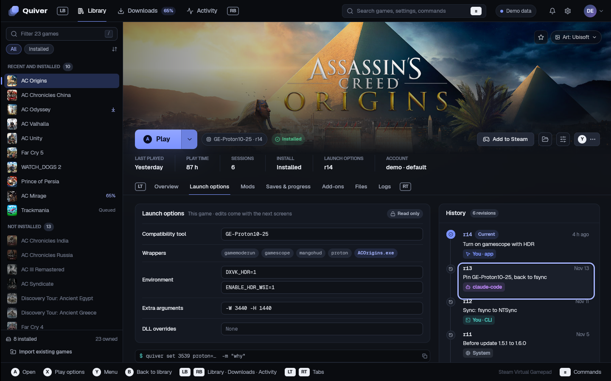
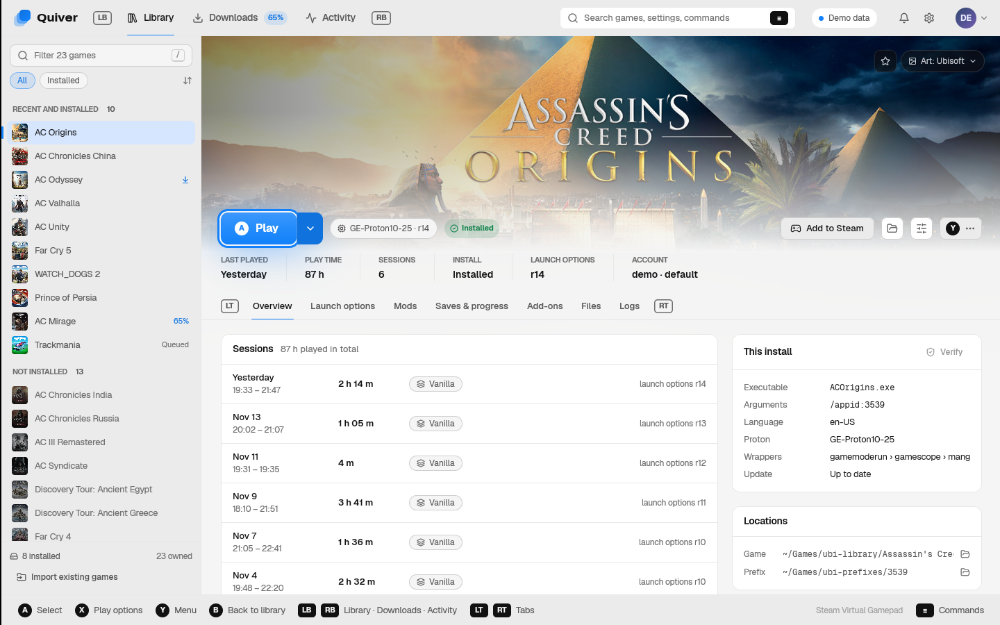

# Quiver

A third-party launcher for your Ubisoft library on Linux. Not affiliated with or endorsed by
Ubisoft.

A native Linux client for a Ubisoft library: sign-in, library, installs and updates, one Proton
prefix per game, cloud saves, play time, mod overlays and Steam/desktop shortcuts, all without
running `UbisoftConnect.exe`. A daemon (`quiverd`) owns everything; the desktop app, the
`quiver` CLI and scripts or agents all drive it the same way.


| Game page (controller) | Launch options with history | Light theme (follows Omarchy) |
|---|---|---|
|  |  |  |

<sub>Screenshots use the app's demo data (`QUIVER_DEMO=1`); box art is Ubisoft's, shown from
their asset CDN.</sub>

## Layout

- `proto/`: Ubisoft Connect protobuf definitions, vendored (see `proto/README.md`)
- `crates/ubi-proto/`: generated protobuf types
- `crates/ubi-core/`: UbiServices auth, the demux client, ownership/library and manifest parsing
- `crates/ubi-cli/`: the `ubi` command
- `crates/ubi-ipc/`: types shared by the native side and the bridge
- `crates/ubi-bridge/`: a Windows binary that runs inside the game's prefix in place of Connect
- `mods/<product id>/<mod id>/quiver-mod.toml`: Quiver's built-in mods (audited recipes,
  compiled into `ubi-core`)
- `tools/instance.sh`: per-game reflinked prefixes, run headless in podman
- `tools/recon/`: SDK harness and the offline recon prefix scripts

## How a game runs without Connect

The game's `uplay_r1_loader64.dll` loads Ubisoft's own `uplay_r164.dll` and `uplay_aux_r164.dll`
from the Connect install directory, unmodified. They reach Connect through named pipes
(4-byte big-endian length + protobuf), and `ubi-bridge` owns those pipes:

| Pipe | Protocol | What the bridge does |
|---|---|---|
| `terminal_1_uplay_aux_ipc_pipe_` | `uplayauxdll` | init, then Denuvo activation: forwards the request token to the broker in `quiverd` |
| `terminal_1_uplay_api_process_ipc_pipe_` | `uplaydll` | `InitProcessReq` handshake |
| `terminal_1_uplay_ipc_pipe_` | `uplaydll` | `InitReq` (account, ticket, owned IDs, CD keys), then the SDK API |

- **`UPLAY_ARGUMENTS`:** the game must be started with this set to
  `-upc_uplay_id <id> -upc_game_version 1 -upc_exe_path <b64> -upc_working_directory <b64>`.
  Otherwise the aux DLL relaunches it through `UbisoftGameLauncher.exe`.
- **Broker (in `quiverd`):** runs on the host and holds the Ubisoft session. For a Denuvo token it fetches
  an `ownership_service` ownership token, then calls `denuvo_service.GetGameTokenReq`.

## Debugging a game against the bridge

- `tools/recon/sdk-proxy`: a logging stand-in for `uplay_r1_loader64.dll` (`install.sh install|remove`).
  Diffing its log from a real Connect session against a bridge session is the fastest way to find
  what the bridge gets wrong. That's how the missing account email (which stops Origins from
  listing saves) was found.
- `tools/proto-extract/extract.py <binary>`: dump the protobuf schemas embedded in Ubisoft binaries.
- `UBI_TRACE=+file tools/instance.sh run ...` then `tools/instance.sh trace-grep <name> <regex>`.

## Architecture

```
 quiver-app (GPUI)   quiver (CLI)   scripts / agents
            \              |              /
             +---- ubi-api: JSON lines over $XDG_RUNTIME_DIR/quiver/quiverd.sock
                            |
                        quiverd  (daemon; started on demand by any client)
            session · library · installs · launches · settings history · activity log
                 · Denuvo token broker for every running game's ubi-bridge
                            |
                         ubi-core (Ubisoft protocols, installer, saves, launcher)
```

Front ends hold no state. Every request carries a source label (`gui`, `cli`, or whatever
`--source`/`QUIVER_SOURCE` says), so the activity log and each game's settings history show who
changed what. Clients outlive a daemon restart: they reconnect on their own, renew their event
subscription, and never resend a request the old daemon may already have run.

## Install

```sh
rustup target add x86_64-pc-windows-gnu
tools/install-user.sh                          # build and install into ~/.local (no root); again to upgrade
tools/package.sh                               # or: an Arch package (quiver-git) for /usr
```

See [packaging/arch/README.md](packaging/arch/README.md) for what goes where, upgrades and
switching from a build directory.

## Usage

To run straight from a build directory instead:

```sh
rustup target add x86_64-pc-windows-gnu
cargo build --release -p ubi-bridge --target x86_64-pc-windows-gnu
cargo build --release
export PATH=$PWD/target/release:$PATH

quiver login                                   # email, password, 2FA (or sign in from the app)
quiver login                                   # again: adds a second account (first stays default)
quiver account list                            # signed-in accounts; * marks the default
quiver account default family                  # change the default (by name or user id)
quiver logout family                           # sign one account out (default: the default)
quiver-app                                     # the app; relaunches itself on the same screen when its
                                               # binary is rebuilt (QUIVER_AUTO_RELAUNCH=0: off)
quiver library                                 # owned games, install state, owners (2+ accounts)
quiver install "chronicles china"              # by name or product id; shows progress
quiver play rabbids                            # runs in its own prefix; syncs cloud saves
quiver set origins proton=GE-Proton10-34 env.DXVK_HUD=fps -m "test HUD"
quiver history origins                         # every revision, with who made it
quiver restore origins 2                       # make revision 2 current again (0 = defaults)
quiver --source agent set origins wrappers=gamemoderun,mangohud
quiver activity                                # recent actions across GUI/CLI/agents
quiver watch                                   # live daemon events (JSON)
quiver export desktop origins [--remove]       # ~/.local/share/applications/quiver-<id>.desktop
quiver export steam origins [--user NAME]      # non-Steam shortcut with Ubisoft art (staged while Steam runs)
quiver export list                             # exports and whether they're still as written
quiver steam users                             # Steam users; which one gets shortcuts
quiver steam restart                           # asks first; writes staged shortcuts while Steam is closed
quiver info origins [--all]                    # publisher, links, size, languages, add-ons (store links for unowned)
quiver progress origins                        # Ubisoft play time, stats, rewards, achievements, Connect level/units
quiver saves origins [--local]                 # local vs cloud slots (sizes, times, which is newer), backups
quiver saves origins restore latest            # backs up the current saves first; agents need your OK
quiver dev …                                   # low-level tools that bypass the daemon

quiver mods odyssey layer add ReShade ~/mods/reshade   # copy a folder laid out like the install
quiver mods odyssey layer add "No intro" --delete videos/intro.bik --delete videos/logo.bik
quiver mods odyssey layer delete-files "No intro" videos/credits   # keep-files PATH… takes it back
quiver mods odyssey layer show "No intro"      # files, origin, what it deletes; history / restore N
quiver mods odyssey profile create "Visual overhaul" --layers hd-textures,ReShade
quiver mods odyssey profile set "Visual overhaul" dll.dxgi=n,b cloud_saves=on
quiver mods odyssey list                       # layers, profiles, file conflicts between layers
quiver play odyssey --profile "Visual overhaul"  # or --profile-id p7f3k2q; vanilla by default
quiver mods odyssey profile history "Visual overhaul"
quiver mods odyssey profile delete "Visual overhaul"   # restorable; saves are kept

quiver mods "far cry 4" catalog                # built-in mods (audited recipes, with sources)
quiver mods "far cry 4" install fc4-raw-mouse  # or a package folder with a quiver-mod.toml
quiver mods "far cry 4" profile set Mouse mods=fc4-skip-intro,fc4-raw-mouse
quiver mods "far cry 4" profile set Mouse profile_config="drive_c/users/steamuser/Documents/My Games/Far Cry 4"
quiver mods "far cry 4" profile set Mouse separate_saves=on   # or off, or auto (the default)
quiver mods "far cry 4" plan Mouse             # settings, saves, mounts, own folders, config patches
quiver mods "far cry 4" show fc4-raw-mouse     # what it declares, where it's used, what it changed
quiver mods "far cry 4" set fc4-raw-mouse enabled=off   # also save_compatible=, kind=, name=
quiver mods "far cry 4" uninstall fc4-raw-mouse   # config values it changed go back
quiver fixes-on-vanilla on                     # installed fixes also apply to unmodded launches

quiver install origins --dry-run               # sizes, free space, languages; nothing starts
quiver queue                                   # the download queue: state, progress, speed
quiver queue move origins top                  # or up / down
quiver pause origins                           # stops at a slice boundary; keeps its place
quiver resume origins                          # also retries a failed item
quiver queue remove origins                    # files stay; installing again resumes
quiver queue settings --max-active 1 --limit 20M --auto-update off
quiver update origins --preview                # files changed/added/removed, bytes to fetch
quiver verify origins [--repair]               # hash files against the manifest; repair fetches only bad slices
```

## Downloads

Installs, updates and repairs go through one queue in `quiverd` (`<data>/queue.json`), one at
a time unless `--max-active` says otherwise. A download refuses to start if what it will write
plus a margin (1 GiB or 5%) doesn't fit on the library's filesystem. Progress is kept per file
(`.ubi-install/done`) and per slice (`.ubi-install/slices`), so pausing, a crash or a daemon
restart loses at most the slices in flight; a restarted daemon resumes what was running and
leaves paused items paused. Each slice is tried up to six times (1 s doubling to 30 s, with
jitter) on connection errors, timeouts, cut-off bodies, 5xx and 429, and its signed URL is
renewed when the CDN refuses it. Updates reuse every slice whose bytes are already in place.
Verify hashes each slice of each file the manifest lists (other files, such as mods or extra
DLLs, are never read or written) and repair re-downloads only the slices that failed; symlinks
and hard links are replaced by files of their own first, and reflinked imports need nothing.

## Mods

A **layer** is a folder of files laid out like the install folder; `layer add` copies it into
`~/.local/share/quiver/mods/<product>/layers/<id>/` (reflinks on btrfs/xfs) and matches file
names to the install's case. A **profile** stacks layers bottom to top, can override launch
settings (`proton`, `env.*`, `dll.*`, `args`, `wrappers`) and, when it forks saves (see
Mods v2 below), has its own (`savegames/<user>/<product>-<profile id>` in the prefix), synced
with the cloud only with `cloud_saves=on`. Vanilla is implicit and only mounted for fixes
that change install files.

A layer can also **delete** files and folders (`--delete PATH`, `layer delete-files`,
`layer keep-files`; paths are relative to the install folder and matched to its case). A
deletion hides the path from the install and from the layers below, only inside a modded
launch; nothing on disk is deleted. In the layer's folder it is an overlayfs whiteout (a
character device 0:0, which needs Linux 5.8+ to create unprivileged), or, for a folder the
layer has files of its own in, an opaque folder (`user.overlay.opaque=y`): the layer's
version replaces the install's whole folder. Whiteouts already in a copied folder are kept as
deletions. The list of deletions is in the layer's metadata; each change is a revision in
`games/<product>/layers/<id>.jsonl` (`layer history`, `layer restore`). Changing deletions is
refused while the game runs, and `mods list` shows layers that provide or delete the same
path.

A modded launch never changes the install folder. `quiverd` starts a holder process that calls
`unshare(CLONE_NEWUSER | CLONE_NEWNS)`, maps your uid and gid to themselves and mounts
overlayfs over the install path (lower: the layers, then the install; upper:
`mods/<product>/profiles/<id>/upper`, where everything the game writes lands). The bridge,
Proton, its wineserver and the game join that namespace with `setns`; the daemon never does.
Profile changes are revisions in `games/<product>/profiles/<id>.jsonl` (`profile history`,
`profile restore`), and deleting a profile is a revision too. Agents (`--source` other than
`cli`/`gui`) need a person's confirmation to delete or restore profiles, restore layer
revisions and remove layers; adding layers and changing their deletions are normal edits.

### Mods v2: packages, stacks, config patches

A **mod** is a folder with a manifest, `quiver-mod.toml` (TOML; `quiver-mod.json` with the
same fields works too), and optionally `files/` laid out like the install folder:

```toml
id = "fc4-raw-mouse"            # lowercase letters, digits, '-'
name = "Raw mouse input"
version = "1"
kind = "fix"                    # or "mod" (the default); only fixes can apply to vanilla
description = "…"
source = "https://www.pcgamingwiki.com/wiki/Far_Cry_4#Mouse_acceleration"
audited = "who checked the recipe, when, against what"
save_compatible = true          # unset counts as false: the profile gets its own saves
products = [420]                # optional; installing elsewhere is refused
builds = []                     # known-good install manifest hashes (warns on others)
requires = []                   # manifest ids that must be in the stack
conflicts = []                  # manifest ids that must not be

[files]                         # install files: files/ (or dir = "…") adds and replaces,
delete = ["videos/intro.bk2"]   # delete hides (whiteouts), as for layers

[launch]                        # appended (args, wrappers) or merged (env, dll) in stack order
args = ["-skipintro"]
env = { DXVK_HUD = "fps" }
dll = { d3d11 = "n,b" }
wrappers = ["gamemoderun"]

[[patch]]                       # INI and XML key edits on files in the prefix
file = "drive_c/users/steamuser/Documents/My Games/Far Cry 4/*/GamerProfile.xml"
format = "xml"                  # or "ini" (with section = "…")
element = "GamerProfile/ProfileSpecificGameProfile"
set = { MouseAcceleration = "0", Smoothness = "0" }
delete = []                     # keys (attributes) to remove; every line of a repeated INI key
```

Installed mods live where layers do (a layer is a file-only mod; v1 layers need no
migration). **Built-in mods** are in `mods/<product id>/<mod id>/` in this repository, each
translated from a source such as PCGamingWiki and audited (`source`, `audited`); `quiver mods
<game> catalog` lists them and `install ID` installs one (again: updates it).

A **profile** is an ordered stack of mods (`mods=a,b`, bottom to top) plus your own
overrides. Settings resolve as defaults → game settings → each mod → the profile: args and
wrappers append in that order (a wrapper isn't added twice), env and DLL overrides merge with
the later one winning, the profile's `proton`/`language` win. Every key set differently by two
sources (env, DLL, or a config key) is reported in `mods list`, after `profile set` and in the
launch's job details; a mod's declared `requires`/`conflicts` stop the launch with a reason.

**Saves** fork only when a mod in the stack isn't save-compatible, or the profile says
`separate_saves=on`; `separate_saves=off` always shares vanilla's (and syncs them with the
cloud like vanilla does); `auto` (the default) follows the mods. A profile that already has
its own saves folder (every v1 profile that was played) keeps using it: launches and `quiver
mods <game> migrate` record `separate_saves=on` for it, and nothing is moved.

**Config patches** are applied at every launch, just before the game starts (the game may
have rewritten the file), as "ensure key = value". The file's own values from before Quiver
touched it are recorded in `mods/<product>/patches.json`, and a key no mod in the launch's
stack wants any more is put back, unless it changed since Quiver set it. A file that doesn't
exist yet is "pending until first run". INI edits keep comments, order, unknown content, line
endings and encoding (UTF-8 or UTF-16); XML edits change attribute values in place.
`undo-patches` puts everything back now; `uninstall` does it for that mod.

**Per-profile prefix folders** (`profile_config=DIR,…`, relative to the prefix): inside the
launch's namespace each folder is overlaid with the profile's own
`mods/<product>/profiles/<id>/prefix/<DIR>`, so the profile sees the prefix's files with its
own changes on top (e.g. its own graphics settings) and vanilla never sees them. Config
patches to files there edit the profile's copy. `mods <game> plan PROFILE` shows which
folders are per-profile, the prefix folder the game sees and where the profile's files
really live. Shared files (outside those folders) are what every launch sees, so a profile's
patch there is undone by the next launch that doesn't want it.

**Fixes on unmodded games**: `quiver fixes-on-vanilla on` (unset means not decided yet; the
first-launch prompt asks) applies installed, enabled `fix` mods to vanilla launches too. A
fix with install files then mounts over the install for vanilla as well, with vanilla's own
writable layer (`mods/<product>/profiles/vanilla/upper`).

Agents may install mods, edit stacks and change a mod's settings; uninstalling a mod that
has install files or changed config values, and `undo-patches`, need a person's OK.

Settings keys: `proton`, `language`, `account`, `args`, `wrappers`, `env.NAME`, `dll.NAME`
(`key=` unsets). A game launches (and installs, syncs cloud saves, reports play time) with its
`account` if set, else the default account if it owns the game, else the first account that does.
State lives in `~/.local/share/quiver/` (`config.json`, `games.json`, `accounts.json`,
`games/<id>/history.jsonl`, `activity.jsonl`, save backups, `quiverd.log`); a pre-Quiver
`~/.local/share/ubisoft-linux/` and keyring entry are moved there automatically. `ubi` is kept
as an alias for `quiver`.

## Roadmap

1. Core and CLI: auth, library, manifests (done)
2. Launch bridge: AC Origins (uplay R1 SDK) reaches the main menu with Denuvo and DLC working (done)
3. Bridge coverage: Origins loads saves and reaches gameplay menus. Still to do: real achievements
   and Club actions (UbiServices), cloud save sync, newer `upc_r2` games, ticket refresh on long
   sessions
4. Installer: done (zstd `slices_v3` and legacy zlib `slices` layouts; updates in place)
5. Cloud saves: done (cloudsave_service V2, pull before / push after each session)
   Play time: reported to Ubisoft like Connect does (UbiServices playsession start, heartbeat
   every 330 s, end; `report_playtime` in config.json turns it off)
6. GPUI front end: library, install/update with progress, play
7. Next: fetch the SDK DLLs from Ubisoft instead of a local Connect install, real
   achievements/Club, LZHAM manifests, `upc_r2` games

## License and credits

Quiver is MIT-licensed (see [LICENSE](LICENSE)). It is an independent project, not affiliated
with or endorsed by Ubisoft; "Ubisoft" and game names are trademarks of their owners. Quiver
needs your own Ubisoft account and only runs games you own.

- `proto/`: protobuf definitions of Ubisoft Connect's protocols, originally vendored from
  [YoobieRE/ubisoft-demux-node](https://github.com/YoobieRE/ubisoft-demux-node) and refreshed
  from the client's embedded descriptors with `tools/proto-extract` (see `proto/README.md`).
- `crates/ubi-app/src/text_input.rs`: adapted from GPUI's `examples/input.rs` (Apache-2.0,
  Copyright Zed Industries).
- `crates/ubi-app/assets`: Geist and Geist Mono (OFL), Archivo (OFL) and Lucide icons (ISC),
  with their license files.
- `third_party/xattr-0.2.3`: the `xattr` crate (MIT/Apache-2.0) with a one-line patch GPUI
  needs; its license files are included.
